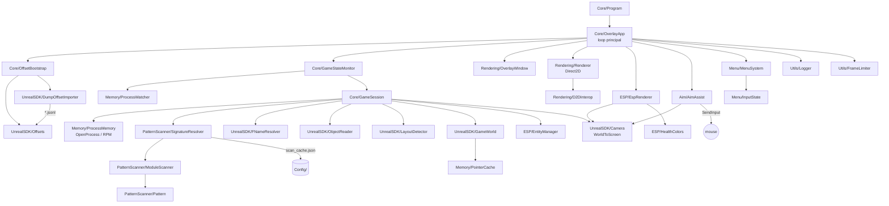
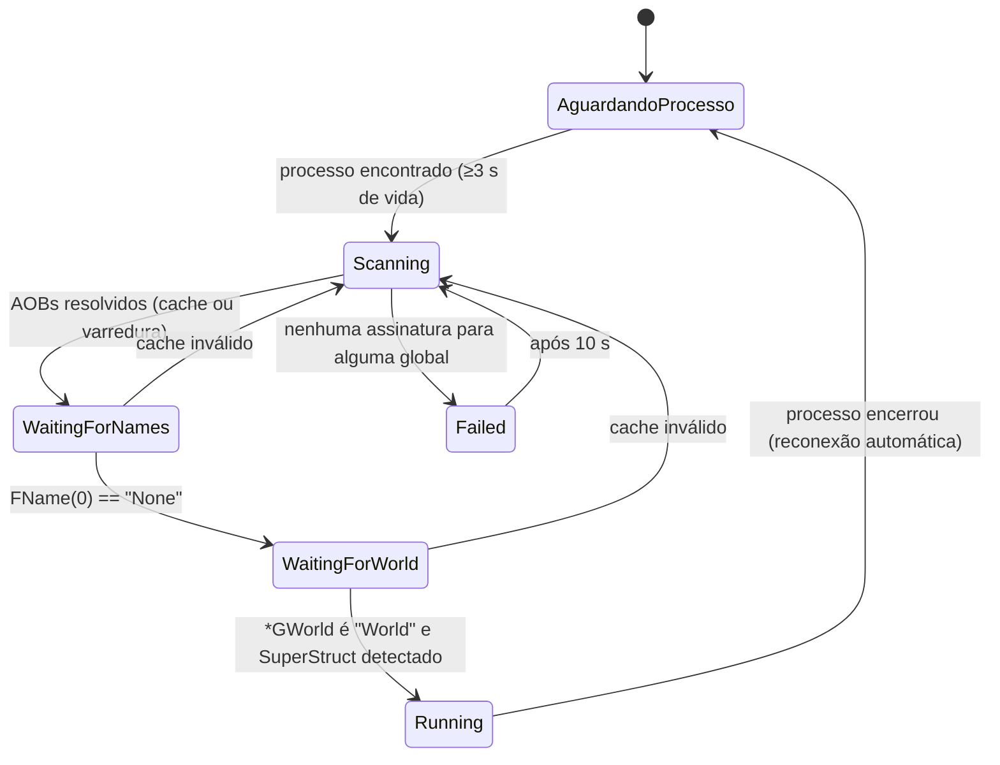

# Arquitetura

O G2Overlay é um processo **externo** (out-of-process) e **somente leitura**: abre o jogo com
`PROCESS_VM_READ | PROCESS_QUERY_LIMITED_INFORMATION | SYNCHRONIZE`, lê memória com `ReadProcessMemory`
e desenha numa janela própria, transparente e sempre no topo. Nada é escrito, injetado ou "hookado" no jogo.

## Estrutura do projeto

```
Overlay/
├── G2Overlay.sln / G2Overlay.csproj / app.manifest   (.NET 8, x64, sem pacotes NuGet)
├── Core/            Program (entrada), OverlayApp (loop), GameStateMonitor (processo/reconexão),
│                    GameSession (máquina de estados de inicialização), OffsetBootstrap
├── Memory/          Native (P/Invoke Win32), ProcessMemory (RPM), ProcessWatcher, PointerCache
├── PatternScanner/  Pattern (AOB estilo IDA), ModuleScanner (PE + varredura em blocos),
│                    Signature, DefaultSignatures, SignatureResolver (cache por build)
├── UnrealSDK/       Types (FVector/FTransform/...), Offsets (tabela), DumpOffsetImporter,
│                    FNameResolver, ObjectReader (UClass/IsA), LayoutDetector, GameWorld, Camera (W2S)
├── Rendering/       D2DInterop (vtable COM direto), Renderer (API de desenho), OverlayWindow
├── ESP/             Creature, Collectible, EntityManager, EspRenderer, HealthColors
├── Aim/             AimAssist (AimBot: seleção de alvo + movimento de mouse por SendInput)
├── Menu/            InputState (teclas/mouse globais), MenuSystem (UI imediata translúcida)
├── Utils/           Logger (assíncrono), LogThrottle, FrameLimiter (timer de alta resolução)
├── Config/          OverlayConfig + ConfigManager, config.json, offsets.json, signatures.json
├── tools/           sigtool.py (regenera assinaturas após patch)
└── docs/            esta documentação
```

## Diagrama dos módulos



## Ciclo de vida



## Loop principal (`OverlayApp.Frame`)

| Etapa | Onde | O que faz |
|---|---|---|
| 1. Leitura de memória / estado | `GameStateMonitor.Tick`, `GameSession.Tick` | detecta/reconecta o processo, avança a inicialização |
| — alinhamento | `ProcessWatcher.TryGetClientScreenRect`, `OverlayWindow.AlignTo` | posiciona o overlay sobre a área cliente da janela `UnrealWindow` |
| 2. Entidades | `EntityManager.ScanIfDue` | percorre `UWorld.Levels[*].Actors` a cada 500 ms |
| 3. Câmera | `GameWorld.Update` + `ReadCamera` | cadeia de ponteiros (cache 250 ms) e `CameraCachePrivate.POV` |
| 4. WorldToScreen | `EntityManager.UpdateFrame`, `Camera.ProjectBox` | posição/vida/bounds por frame, projeção dos 8 cantos da AABB |
| 5. ESP | `EspRenderer.Draw` | caixa verde, barra de vida colorida, nome/distância |
| 6. Menu | `MenuSystem.Draw` | UI translúcida; captura cliques só quando aberto |
| 7. Logs | `Logger` (thread própria), `SamplePerformance` | resumo de entidades a cada 5 s, desempenho a cada 30 s |
| FPS | `FrameLimiter.EndFrameAndWait` | timer de alta resolução, sem spin; 10 FPS quando o jogo não está visível |

## Decisões de projeto

**Direct2D direto por vtable em vez de WinUI/SharpDX.** WinUI 3 não oferece janela *click-through* com
transparência por pixel sobre outra aplicação. SharpDX está descontinuado. A técnica usada (janela
`WS_EX_LAYERED | WS_EX_TRANSPARENT | WS_EX_TOPMOST | WS_EX_NOACTIVATE`, `DwmExtendFrameIntoClientArea(-1)` e
`ID2D1HwndRenderTarget` com alpha pré-multiplicado) é a mesma de bibliotecas de overlay consolidadas.
Chamar Direct2D/DirectWrite pela vtable (≈20 métodos) elimina qualquer dependência NuGet: o projeto compila só
com o SDK do .NET.

**Menu e cliques.** Com o menu fechado a janela tem `WS_EX_TRANSPARENT` (todo clique vai para o jogo). Ao abrir
(INSERT) o estilo é removido e o overlay recebe os cliques, sem nunca roubar o foco (`WM_MOUSEACTIVATE →
MA_NOACTIVATE`). Teclas e mouse são lidos por `GetAsyncKeyState`, portanto funcionam com o foco no jogo.
O jogo prende o cursor no centro durante a jogabilidade; para clicar no menu, abra um menu do próprio jogo
(ex.: inventário) para liberar o cursor.

**Offsets por nome, não por número.** A tabela `Off` usa chaves `Classe.Propriedade`. Os valores vêm de
`offsets.json`, regenerado automaticamente a partir do dump mais recente. Os membros não refletidos são
detectados e validados em runtime (`LayoutDetector`) e gravados de volta em `offsets.json`.

**Detecção de criaturas pela herança.** `ObjectReader` resolve a cadeia `SuperStruct` de cada `UClass` uma
única vez (cache por ponteiro). Toda classe cuja cadeia contém `SurvivalCreature` é criatura; o mesmo vale para
blueprints novos que o jogo adicionar em patches. Ao criar cada criatura, o `HealthComponent` é conferido
(a classe precisa derivar de `HealthComponent`): se não derivar, os offsets estão desatualizados e o problema
aparece no log.

**Autocorreção dos caches (sem precisar de "Recarregar").** Durante o streaming de níveis o jogo descarrega e
recarrega classes e atores, e endereços liberados são reaproveitados por objetos diferentes. Antes, um cache
indexado por endereço podia ficar apontando para a classe antiga até o botão Recarregar. Agora:

| Mecanismo | O que evita |
|---|---|
| `ClassInfo` guarda o `FName` e o `SuperStruct` da classe; a cada 1 s de uso eles são relidos (2 leituras) e, se mudaram, a cadeia é refeita | classe nova no endereço de uma classe descarregada herdando o resultado antigo |
| cadeias que não terminam em `Object` não entram no cache | leitura que falhou no meio marcando a classe como "não é ator" para sempre |
| entradas do cache de classes vencem após 5 min | rede de segurança para qualquer caso não previsto |
| resultado do filtro de coletáveis guardado no próprio `ClassInfo`, com número de versão dos filtros | resultado de uma classe antiga valendo para outra |
| cache negativo, criaturas e coletáveis guardam a posição (nível, índice) em `Level.Actors`; mudou → reclassifica na hora | ator novo nascendo num endereço reaproveitado e sendo ignorado até a expiração |
| criatura sem ponto fraco tenta de novo até 5 vezes, a cada 2 s | componentes criados depois do spawn |
| troca de `UWorld` limpa também o cache de classes | mundo novo herdando classes do anterior |

O resumo periódico do log mostra os contadores: `autocorreção: classes trocadas=…, cadeias incompletas=…,
endereços reaproveitados=…`. O botão **Recarregar** continua existindo (reimporta offsets e refaz as validações
de layout), mas não deve mais ser necessário durante o jogo.

**Vida.** `Vida = MaxHealth × (NG+ × modo personalizado × propriedade) − CurrentDamage`, limitada a [0, Max].
Os multiplicadores fora de (0,01; 100) são tratados como 1. A opção `ApplyHealthMultipliers` permite desligar.

**Bounding box.** Por padrão usa `Mesh.Bounds` (AABB da malha esquelética, que envolve a criatura inteira,
inclusive patas de aranha). Se os bounds não forem plausíveis, cai na cápsula de colisão
(raio × raio × meia-altura). Os 8 cantos são projetados e o retângulo envolvente é desenhado.

## Desempenho

| Recurso | Estratégia |
|---|---|
| CPU | sono real entre frames; scan de atores a cada 500 ms; cache negativo de atores com expiração aleatória (revalidação gradual, no máx. 3.000 classificações por scan); cache de classes e FNames; cadeia de ponteiros com TTL de 250 ms; 1 leitura em bloco por array |
| Leituras/frame | ~2 da câmera + ~3 por criatura dentro do alcance (posição, vida em bloco, bounds) |
| RAM | sem cópia do módulo (varredura em blocos de 8 MB via `ArrayPool`), GC de estação não concorrente, dicionários com teto |
| GPU | uma render target, um único pincel reutilizado (`SetColor`), três formatos de texto |

O menu mostra em tempo real FPS, tempo de frame, CPU %, RAM e leituras por segundo. O log grava um resumo de
desempenho a cada 30 s.

## AimBot (Aim/AimAssist)

**Memória:** só leitura. O AimBot não escreve na memória do jogo e não altera a rotação do controller. Ele gera
movimento relativo de mouse com `SendInput(MOUSEEVENTF_MOVE)`, que o jogo recebe como entrada bruta, igual a um mouse físico.

**Quando age:** `AimEnabled` ligado, tecla `AimKey` pressionada, janela do jogo em primeiro plano e menu fechado.

**Seleção de alvo:**
- Candidatas: criaturas visíveis no ESP, vivas (`HealthState != Dead`), não nocauteadas (exceto com
  `AimTargetIncapacitated`), não domadas (pets/buggies, com `AimIgnoreTamed`) e a até `AimMaxDistanceMeters`.
- Jogadores (`SurvivalPlayerCharacter`) são excluídos sempre.
- Ponto de mira: centro da caixa da criatura (`Mesh.Bounds`), deslocado na vertical por `AimHeight`, projetado com o mesmo WorldToScreen do ESP.
- Escolha: o ponto mais próximo do centro da tela dentro do círculo `AimFovPixels`.
- O alvo fica travado enquanto a tecla está pressionada e ele continua válido e dentro de 1,5× o FOV (histerese, evita troca de alvo no meio do movimento).

**Controle (malha fechada):**
```
erro = ponto_de_mira − centro_da_tela                (pixels)
passo = clamp(erro × AimGain / AimSmoothing, ±AimMaxStep) + resto_fracionário
SendInput(trunc(passo))                               (resto guardado para o próximo frame)
```
O erro é medido de novo a cada frame, então a mira converge com qualquer sensibilidade de mouse ou FOV, sem calibração.
`AimSmoothing` maior deixa o movimento mais lento e suave; `AimGain` faz o ajuste fino. Se oscilar em volta do alvo,
aumente `AimSmoothing` ou diminua `AimGain`.
